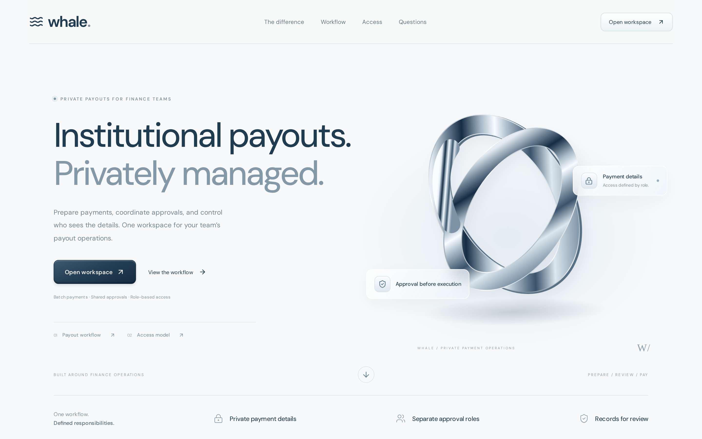
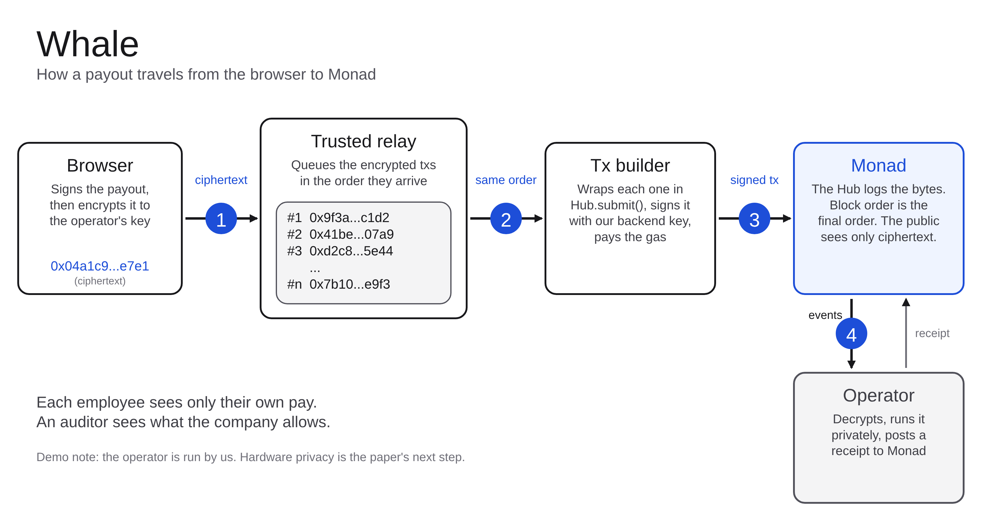

<div align="center">

# 🐋 Whale

**Institutional funds privacy at ease.**

Private batch payouts for organizations, settled on [Monad](https://monad.xyz).
A finance team pays 50 people in one transaction. The public sees nothing, each person sees only their own pay, and the auditor sees what the company allows.

[**Live demo**](https://whale-web-five.vercel.app) · [PRD](PRD.md) · [API](docs/API.md) · [Deploy](docs/DEPLOY.md) · [Demo script](docs/DEMO_SCRIPT.md)




</div>

---

## The problem

On a public chain, a payroll wallet exposes everyone's salary. Whale keeps payout data encrypted end to end, while still settling on a public, liquid chain with auditable receipts.

## How a payout travels

<p align="center"></p>

1. **Browser** signs the payout and encrypts it to the operator's key (ECIES, secp256k1 + AES-256-GCM).
2. **Trusted relay** queues the encrypted transactions in arrival order.
3. **Tx builder** wraps each in `Hub.submit()`, signs it with the backend key and pays the gas.
4. **Monad** logs the bytes. Block order is the final order; the public sees only ciphertext.
5. **Operator** decrypts, executes privately on a domain chain, builds Merkle trees, and posts a signed (2-of-3) result back to the Hub.

This is a "PSD-lite" demonstration of the pattern in the Category Labs *Monad Private Settlement Domains* white paper.

## Roles

| Role | Can do | Sees |
|---|---|---|
| Finance lead | Upload a CSV batch, propose a payout | Batch status, own proposals |
| Approver (2 of 3) | Approve a proposed batch | Pending batch totals and payee count |
| Payee | View own pay, withdraw | Only their own balance and payments |
| Auditor | View the full table, verify a receipt | Everything the finance lead authorised |
| Public | Browse the Monad explorer | Ciphertext and the Hub address |

## Repository

| Path | Contents |
|---|---|
| `contracts/` | Solidity (Foundry): `Hub`, `MainBridge`, `MockSwap`, tokens on Monad; `DomainToken`, `Treasury` on the private side |
| `operator/` | Operator, relayer, proxy and API (Node 20, TypeScript, private anvil chain 7777) |
| `web/` | Next.js app: landing page and `/workspace` |
| `docs/` | API contract, backend spec, deployment, Uniswap notes, architecture diagram source |

## Quick start

```bash
# backend
cd operator && pnpm install && pnpm bootstrap && pnpm start   # API on :8787

# frontend
cd web && npm install && npm run dev                          # http://localhost:3000
```

Copy `.env.example` files and fill in your own keys; `.env` is git-ignored. See [docs/DEPLOY.md](docs/DEPLOY.md) for the Vercel + ngrok deployment.

## Honest limits

- The operator sees all data; it is run by us. Hardware (TEE) privacy is the paper's next step.
- Testnet and mock tokens only. No KYC, tax or regulatory claims.

---

<div align="center"><sub>Built for Monad Mumbai.</sub></div>
